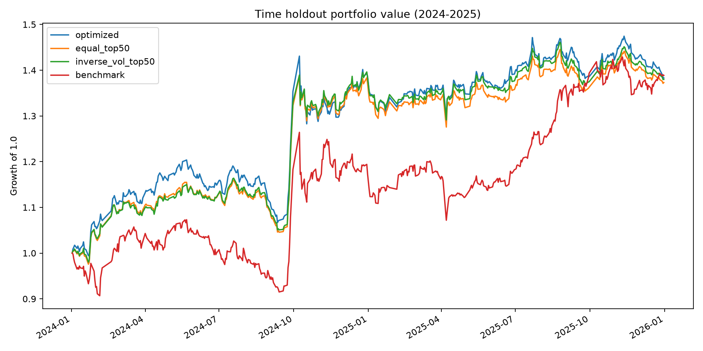

# A股多因子组合优化与交易约束研究

历史时点多因子选股之后的组合构建研究。项目检验同一个Alpha信号在等权、分数加权、逆波动率加权和风险约束优化下，能否在交易成本、权重上限和换手约束内形成更稳健的组合。

## 核心结论

- 使用四因子等权复合信号：20日动量、5日反转、20日低波动和20日低换手。
- 2024–2025时间外验证中，风险约束优化组合扣成本后CAGR为18.68%，Sharpe为1.15，最大回撤为-11.38%。
- 同期动态沪深300等权净基准CAGR为17.97%，Sharpe为0.93，最大回撤为-15.21%。
- 优化组合相对基准总收益高1.60个百分点，风险调整表现更好，但并没有稳定跑赢Top 50等权组合；后者同期Sharpe为1.15，最大回撤为-9.81%。因此，本研究的Alpha信号贡献大于优化器本身，不能把结果解释为组合优化带来了稳定Alpha。
- 2024–2025是根据现有数据回溯划分的时间验证区间，不是预先注册的锁定OOS。



完整结果见 [`docs/results.md`](docs/results.md)，方法说明见 [`docs/methodology.md`](docs/methodology.md)，复现与约束审计见 [`docs/verification.md`](docs/verification.md)。

## 研究设计

### 股票池与信号

数据来自第一项研究冻结的Baostock历史数据：

- 291个五日历史成分快照，每次恰好300只股票；
- 481只历史成分股，731,507条后复权行情；
- 信号在交易日收盘后生成，下一交易日开盘执行；
- 未来收益只用于研究诊断，在信号和目标权重冻结后另行附加；
- 过滤ST、停牌、上市历史不足120个交易日及20日日均成交额低于3,000万元的股票。

Alpha默认由以下四个横截面排名字段等权合成：

| 因子 | 方向 |
|---|---|
| 20日价格动量 | 越高越好 |
| 5日价格反转 | 近期跌幅越大越好 |
| 20日波动率 | 越低越好 |
| 20日换手率 | 越低越好 |

项目也支持从CSV载入外部预测分数，后续可以直接接入第二项研究的滚动样本外预测结果。

### 风险模型

- 使用信号日前120个交易日收益估计协方差；
- 对样本协方差和对角协方差执行20%收缩；
- 特征值截断，保证协方差矩阵半正定；
- 记录组合事前波动率和相对市场等权收益的Beta。

### 组合优化

在每个信号日从Alpha前50只股票中构建组合，满足：

- 只做多；
- 权重和为1；
- 单票最大权重5%；
- 年化事前波动率不超过22%；
- 单次单边换手不超过50%；
- Beta位于目标值1.0上下0.20；
- 不再买入已跌出候选池的旧持仓，但允许在换手限制内逐步退出。

优化目标是最大化组合Alpha分数，并对权重平方增加极小的数值正则项。若控制器无法求解，会依次放宽波动率目标并回退到逆波动率或等权配置，同时记录原因。

### 回测与交易

- 信号在收盘后生成，下一交易日开盘执行；
- 停牌或开盘接近涨停时不买入；
- 停牌或开盘接近跌停时不卖出；
- 使用前一交易日已知的20日平均成交额限制单笔交易；
- 单笔不超过20日平均成交额的5%；
- 佣金3 bps，单笔最低5元；
- 滑点5 bps；
- 卖出印花税按2023-08-28前后分别使用10 bps和5 bps；
- 买盘按资金上限等比缩放，避免按股票代码顺序分配剩余现金；
- 不使用杠杆，不假设个股融券。

## 对照组合

| 组合 | 说明 |
|---|---|
| `benchmark` | 当期全部合格股票等权，使用相同交易约束和成本 |
| `equal_top50` | Alpha前50只股票等权 |
| `score_top50` | 按Alpha分数加权 |
| `inverse_vol_top50` | Alpha前50只股票逆波动率加权 |
| `optimized` | 风险、权重、换手和Beta约束优化 |
| `optimized_gross` | 优化组合的零成本诊断版本 |

## 运行

项目指定的Python解释器：

```text
C:\Users\ad\.conda\envs\teach\python.exe
```

直接运行：

```powershell
cd D:\找工作\个人材料\a-share-portfolio-optimization
C:\Users\ad\.conda\envs\teach\python.exe run.py
```

运行测试：

```powershell
C:\Users\ad\.conda\envs\teach\python.exe -m unittest discover -s tests -v
```

审计输入哈希、目标权重、风险约束、换手、净值和交易日志：

```powershell
C:\Users\ad\.conda\envs\teach\python.exe scripts\validate_outputs.py
```

### 接入第二项研究的预测

外部Alpha文件需要三列：

```csv
date,code,score
2024-01-02,000001,0.31
2024-01-02,000002,-0.12
```

运行：

```powershell
C:\Users\ad\.conda\envs\teach\python.exe run.py --alpha-source external --external-alpha path\to\predictions.csv
```

系统要求每个调仓日与合格股票池的匹配率至少达到90%，否则直接失败，避免把残缺预测结果当作完整模型。

## 项目结构

```text
src/portfolio_research/
  config.py       # 参数、日期与成本模型
  data.py         # 行情、历史成分和交易状态
  signals.py      # 因子、横截面排名和外部Alpha接口
  risk.py         # 收缩协方差与Beta估计
  optimizer.py    # 权重、风险、换手约束优化
  backtest.py     # 次日开盘执行与交易成本
  evaluate.py     # 绩效、跟踪误差和超额收益
  pipeline.py     # 全流程和结果输出
tests/
data/raw/         # 冻结输入数据
data/processed/   # 信号、权重、交易、净值与诊断
figures/          # 时间外验证图表
docs/             # 方法、结果与数据说明
```

## 已知限制

- 没有可靠的逐日历史行业分类，因此本次运行未做行业中性化；项目三没有伪装成已经完成行业约束。
- 历史成分只在五日调仓日取快照。
- 120日风险窗口中仍缺失的少量收益按0处理，可能低估停牌风险。
- 后复权合成价格不等同于真实逐笔成交价格。
- 没有模拟100股整手、红利税、盘口排队、永久市场冲击和真实借券成本。
- 换手限制使用上一期目标权重计算，实际交易受阻会令下一期实际持仓偏离目标。
- 2024–2025区间已经被原始研究观察过，不能表述为完全盲测。
- 优化组合没有稳定跑赢Top 50等权组合，结果应解释为风险控制和交易约束分析，而不是优化器有效性证明。

本项目用于量化实习展示和方法复盘，不构成投资建议。
